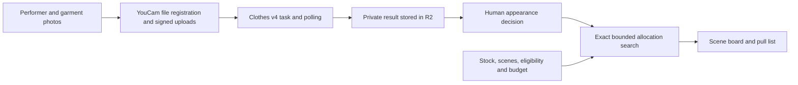

# SceneRack

**One jacket. Two actors. One scene.** Small theatre productions can approve beautiful costume ideas that compete for the same physical wardrobe. The conflict becomes an extra rental, or a rushed change at the fitting.

SceneRack puts the sourcing decision next to the visual decision. Preview a garment on a performer with YouCam, approve its appearance, then get a scene-by-scene allocation and a pull/borrow/rent list that respects the actual stock.

In the fictional sample, approving an owned brown jacket changes the acquisition cost from **$65 to $0**. Reject that look and the rental returns. These are modeled sample costs, not measured customer savings.

[Open the private review app](https://scenerack.abhinav-0905.chatgpt.site) · [Public source](https://github.com/Abhinav0905/scenerack) · [CI checks](https://github.com/Abhinav0905/scenerack/actions)

The hosted app currently requires the owner's ChatGPT sign-in. Judge access must be enabled and checked before submission. The recorded examples and planning flow also run locally without a YouCam key.

## Try the sample

1. Open the studio. The scene board shows Maya and Leo competing for the only navy blazer. The current approved plan needs a $65 burgundy cardigan rental.
2. Choose **Review alternative**. Compare Maya's original photo with the recorded, real YouCam brown-jacket result. The garment reference stays visible.
3. Choose **Approve this look**. Maya gets brown, Leo gets navy and the rental drops out.
4. Open **Pull & rent**, then **Export pull list**. Every physical piece is counted once.
5. Go back and **Reject the look**. The $65 rental returns. Or mark brown unavailable in Wardrobe: the stock constraint changes the plan.
6. For a fresh API request, check the image-sharing consent below a saved example and choose **Generate a fresh preview**. It uses two verified YouCam units. Recorded results stay labeled.

The app also supports replacing performer and garment photos, editing acquisition costs, setting wearer/scene eligibility, explicitly authorizing a nonoverlapping handoff, a budget ceiling, notes and saved decision history. The prototype uses one continuous look per performer. The provided cast and scene plot are the focused sample; this is not a general theatre-management suite.

## Verified results

- 12 real YouCam Clothes v4 requests completed. Their unchanged outputs, input hashes and timings are in [the result manifest](public/previews/manifest.json).
- 11 outputs were useful for limited appearance review in an AI-assisted visual inspection. Leo/brown added rolled cuffs and should be flagged. [Per-image observations](docs/preview-quality-review.md).
- 23 planning and admission checks pass, including 200 deterministic randomized wardrobe scenarios.
- 18 local HTTP checks pass for saving, source invalidation, workspace isolation, upload ownership, consent and concurrent saves.
- Observed request-to-saved-result time: 11.3–21.9 seconds with ten-second polling. This is not a model latency benchmark.

All source people are synthetic adults. Garment references are synthetic and unbranded. Inputs were made with image generation; try-on outputs came from YouCam. No interviews, real customers, market adoption or physical-fit accuracy are claimed.

## Run locally

Node 22.13 or later is required. Install the lockfile dependencies, generate the deployment config and initialize local storage:

```sh
npm ci
npm run build
node --import ./scripts/sites-env.mjs ./node_modules/wrangler/bin/wrangler.js d1 execute DB --local --config dist/server/wrangler.json --persist-to .wrangler/state --file drizzle/0000_fresh_mordo.sql
npm run dev -- --port 3100
```

Open `http://127.0.0.1:3100`. The recorded API examples and complete planning flow work without an API key. To generate new previews, create the ignored `.dev.vars` from [.dev.vars.example](.dev.vars.example) and enter your existing YouCam key. Restart the server after changing local secrets.

```sh
npm run typecheck
npm test
npm run test:http
npm run build
```

`test:http` expects the local server on port 3100 and creates isolated synthetic test workspaces. It does not generate paid API results. Set `SCENERACK_TEST_URL` only for a test instance you control. The build uses the supplied Sites/Vinext integration; D1 migrations and R2 are provisioned by the Sites publishing workflow. The checked-in project ID belongs to this deployment; create a different Site identity for a fork.

## How it works



`lib/planner.ts` enumerates the bounded candidate combinations, prunes higher-cost branches and minimizes acquisition cost in integer cents. Preference breaks cost ties. Availability, recorded wearer eligibility, required scenes and explicit approvals are hard conditions. A physical garment cannot go to two performers in overlapping scenes, even if a handoff is permitted. Without handoff permission it stays with one performer for the production.

The API lives in `app/api`. Production state and preview jobs are stored in D1. Uploads and fresh results are stored in R2 and checked against the requesting workspace. On Sites, identity comes from the trusted platform auth headers; anonymous local sessions use an HttpOnly cookie. Do not expose the Worker directly behind a proxy that accepts client-supplied `oai-authenticated-user-id` headers as trusted identity.

YouCam integration: register two JPEG files, send their bytes to signed upload URLs, create `/s2s/v2.0/task/cloth-v4`, poll `data.task_status`, read `data.results.url`, then save the actual image. Bearer authorization is sent only to the YouCam API, never to signed upload/download destinations. [Verified contract and official references](docs/youcam-contract.md).

Generation checks the current task price (maximum two units) and balance. Admissions are bounded by an atomic global allowance, a per-workspace allowance and at most two active jobs per workspace. The balance check reserves 12 units and also accounts conservatively for in-flight requests. A confirmed error may be retried deliberately. An uncertain task submission is retained and never automatically duplicated. Existing successful requests are reused. The global allowance is per deployment, not an account-wide billing limit.

## Evidence and recording

- [Recording script and shot list](docs/recording-script.md)
- [Devpost draft](docs/devpost-draft.md)
- [Judging criteria and submission checklist](docs/judging-checklist.md)
- [Visual quality review](docs/preview-quality-review.md)
- [Source asset provenance](docs/assets.md)

A generated appearance is not a fitting. Measurements, mobility, condition, exact trim, lighting and changeover timing still need human checks. The next validation should be a task session with a costume lead using real wardrobe stock. The current evidence supports a working prototype, not a proven business.
